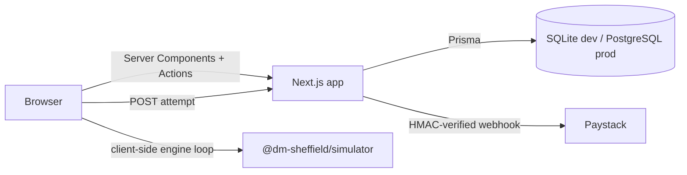

# Architecture

## Overview

DM Sheffield LMS is a modular monolith (per PRD ADR-1), built as an npm
workspaces monorepo:

```
DM Sheffield/
├── apps/
│   └── web/              Next.js 16 (App Router) application — the only deployable app
├── packages/
│   └── simulator/        @dm-sheffield/simulator — framework-independent P&ID engine
├── docs/                 This documentation set
└── package.json          Workspace root
```

Next.js serves as both the web client and the API layer (Route Handlers +
Server Actions), avoiding a separate backend service for this MVP — consistent
with the PRD's "start as a modular monolith" principle. Background workers
(video transcoding, scheduled reminders) are not yet implemented; they are a
natural extraction point if/when those features are built.

## Module boundaries (apps/web/src)

| Boundary | Location |
|---|---|
| Auth & session | `auth.ts`, `auth.config.ts`, `middleware.ts`, `lib/rbac.ts` |
| Catalogue & course delivery | `app/(site)/training/**`, `app/learn/**`, `lib/data/courses.ts`, `lib/data/learning.ts` |
| Assessments | `app/learn/[slug]/[lessonId]/quiz/**` |
| Certificates | `lib/certificates.ts`, `app/(site)/certificates/**` |
| Payments | `lib/payments/paystack.ts`, `app/(site)/checkout/**`, `app/api/webhooks/paystack` |
| Simulator scenarios & attempts | `packages/simulator`, `components/simulator/**`, `app/(site)/simulator/**`, `app/api/simulator/attempts`, `lib/data/simulator.ts` |
| Administration | `app/admin/**` |
| Notifications (email) | `lib/email.ts` |
| Audit logging | `AuditLog` Prisma model, written from every sensitive mutation (course publish, role change, payment, certificate issuance) |

## Simulator package (`packages/simulator`)

Deliberately framework-independent (no React/Next imports) so it can be:

- Unit tested in isolation with Vitest (17 tests covering valves, pumps,
  levels, instruments, controllers, alarms, events, trips, reset, replay
  determinism, objective completion, and scenario validation).
- Reused by a future mobile client or standalone authoring tool without
  pulling in the web app.

It exports: `ScenarioSchema` (Zod), `parseScenario`, `SimulationEngine`,
`replay`, and the 3 bundled `starterScenarios`. The web app imports it as a
normal npm workspace dependency (`@dm-sheffield/simulator`) and runs the
engine **client-side**, per PRD SIM-3 ("runs in the browser"). Attempt logs
are POSTed to the server for persistence and (future) server-side re-scoring
of high-stakes attempts (ADR-3).

## Data flow for a simulator run

1. `/simulator/[scenarioKey]` loads the static scenario JSON via
   `getScenarioById` (no DB round trip needed to start a run).
2. `SimulatorWorkspace` constructs a `SimulationEngine` and steps it on a
   `setInterval` at the scenario's `timeStepMs`.
3. User actions (`applyAction`) are recorded in the engine's action log.
4. On run end, the full snapshot (score, passed, actionLog, duration) is
   POSTed to `/api/simulator/attempts`.
5. The route handler lazily ensures a `SimulationScenario` +
   `SimulationScenarioVersion` row exists (idempotent upsert from the bundled
   JSON — this is a code asset, not seeded business data) and creates a
   `SimulationAttempt`.
6. If the run was launched from a course lesson (`lessonId`/`enrollmentId`
   query params), the lesson's progress is marked complete and certificate
   eligibility is re-checked.

## Key technical decisions (ADRs, per PRD section 6.4)

- **ADR-1 (monolith vs services):** Modular monolith, as above.
- **ADR-2 (backend language):** TypeScript on Next.js (no separate backend).
- **ADR-3 (simulator engine location):** Browser-side engine; server
  persists the action log for replay/audit. Server-side re-scoring of
  high-stakes attempts from the stored action log is supported by the
  engine's `replay()` export but not yet wired into an automated
  re-verification job.
- **ADR-4 (video hosting):** Not decided — no video pipeline built yet; see
  `docs/DECISIONS.md` #7.
- **ADR-5 (hosting region):** Not decided — deployment target unconfirmed.
- **ADR-6 (payment gateway):** Paystack selected as the primary integration
  target (PRD's suggested Nigerian-market gateway); Flutterwave not
  implemented.

## Request flow summary


